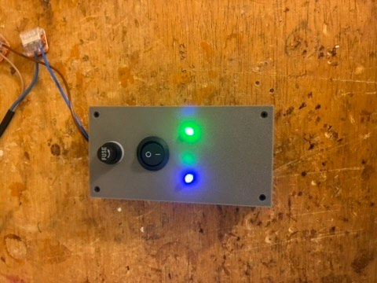
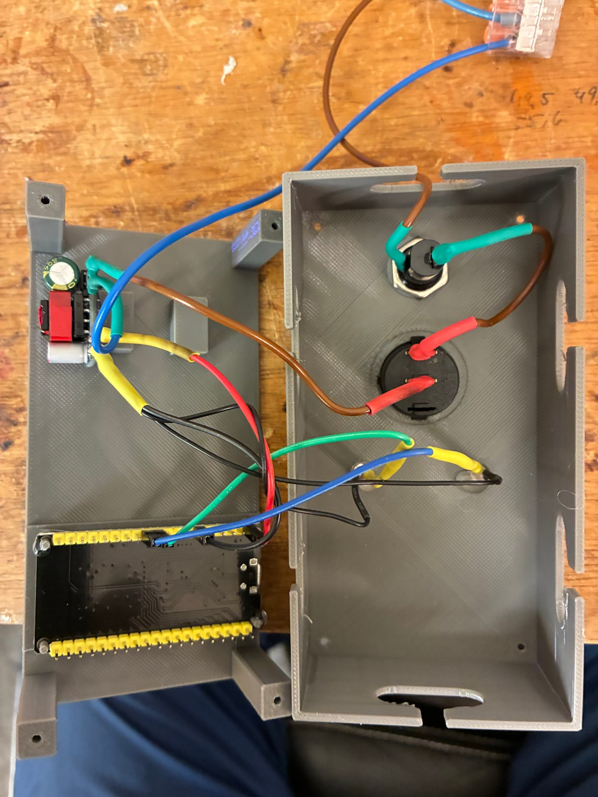

# Aufbau

[Schaltplan](wiring.svg) · [Gehäuse](enclosure.stl)

- ESP32-WROOM-32 auf AZ-Delivery Dev Kit C; 4-MB-Buildprofil vor Nutzung am konkreten Board prüfen.
- Netzteil-Ausgang 5 V DC an Board 5V und GND.
- F1: 100 mA; S1 ist im Plan einpolig im L-Zweig gezeichnet. Sicherungscharakteristik ist nicht spezifiziert.
- GPIO25 → eigener 470-Ω-Widerstand → Anode der blauen LED, Kathode → GND.
- GPIO26 → eigener 470-Ω-Widerstand → Anode der grünen LED, Kathode → GND.
- Blau dauerhaft: WLAN verbunden; blau blinkend: kein Standort-WLAN verbunden.
- Grün dauerhaft: frische erfolgreiche FRITZ!Box-Abfrage, MQTT verbunden und erwartete Abonnements bestätigt. Grün blinkt bei vorhandenem WLAN, solange diese Bereitschaft fehlt.

Die Anzeige bestätigt keine einzelne Ventilbewegung oder den Empfang bei einem nachgelagerten System. Die Schaltung zeigt logische Anschlüsse, keine maßstäbliche Pinlage. Fotos sind eigene Aufnahmen, für die Veröffentlichung ohne EXIF/GPS-Metadaten abgeleitet. STL und Zeichnung sind projektbezogene Autorenunterlagen; aus den Fotos wird keine elektrische Zertifizierung abgeleitet.
